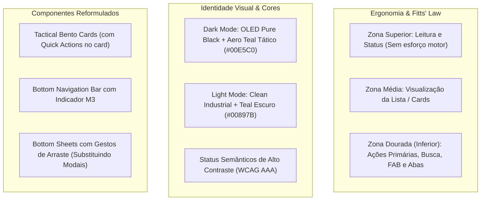

# Blueprint de Redesign: Binfae Mobile Pro 2.0
*(Mobile-First · Touch-First · Material 3 Militar)*

---

## 1. Visão Geral e Filosofia do Redesign

Este documento estabelece o **novo conceito de design** para o aplicativo móvel **Informatica BINFAE-GL** (`BinfaeMobileApp`). Baseando-se nas diretrizes das skills de engenharia de interface (**`mobile-design`**, **`ui-ux-pro-max`**, **`crossplatform-ui-enhancer`** e **`ai-ui-auditor`**), o objetivo é transformar o aplicativo em uma ferramenta tática de alta performance operacional, com ergonomia perfeita para uso com uma mão, contraste visual impecável em ambientes claros ou noturnos (OLED) e zero atrito de navegação.



---

## 2. Nova Identidade Visual e Sistema de Cores (Design Tokens)

A nova paleta abandona cinzas genéricos e adota o estilo **Dark Mode OLED Tático** (com alta eficiência energética em displays AMOLED de viaturas e bancadas) acompanhado de um **Light Mode Industrial** de alta visibilidade sob luz solar intensa.

### 2.1. Tokens de Cor (Dark Mode vs. Light Mode)

| Função do Token | Dark Mode (OLED Tactical) | Light Mode (High-Visibility) | Uso no App |
| :--- | :--- | :--- | :--- |
| **Background Base** | `#070A0F` *(OLED Deep)* | `#F8FAFC` *(Off-White Clean)* | Fundo de todas as telas |
| **Surface (Nível 1)** | `#0E1422` *(Navy Slate)* | `#FFFFFF` *(Branco Puro)* | Headers, Top Bar, Bottom Bar |
| **Surface (Nível 2 / Cards)** | `#151E30` *(Dark Slate Card)* | `#FFFFFF` *(Borda `#E2E8F0`)* | Cards de materiais, caixas de métricas |
| **Border / Divisor** | `#222E46` *(Slate 700)* | `#E2E8F0` *(Slate 200)* | Bordas sutis, divisores de lista |
| **Primária (Aero Teal)** | `#00E5C0` *(Fluorescente HUD)* | `#00897B` *(Teal Aeronáutico)* | Botões principais, FAB, tabs ativas |
| **Secundária / Link** | `#38BDF8` *(Sky Blue)* | `#0284C7` *(Blue 600)* | Links, identificadores secundários |
| **Texto Primário** | `#F8FAFC` *(100% Legibilidade)* | `#0F172A` *(Slate 900)* | Títulos e nomes de materiais |
| **Texto Secundário** | `#94A3B8` *(Slate 400)* | `#475569` *(Slate 600)* | Localizações, categorias, datas |

### 2.2. Paleta Semântica de Status (Padronização FAB)

- 🟢 **Disponível**: `#10B981` (Fundo Dark: `rgba(16, 185, 129, 0.14)`) — Item em estoque pronto para uso.
- 🟡 **Cautelado / Missão**: `#F59E0B` (Fundo Dark: `rgba(245, 158, 11, 0.15)`) — Sob posse de militar/setor.
- 🔴 **Manutenção Técnica**: `#EF4444` (Fundo Dark: `rgba(239, 68, 68, 0.15)`) — Na bancada ou aguardando reparo.
- 🟣 **No Setor (Fixa)**: `#8B5CF6` (Fundo Dark: `rgba(139, 92, 246, 0.15)`) — Computadores e switches em gabinetes.
- ⚪ **Baixado / Descarte**: `#64748B` (Fundo Dark: `rgba(100, 116, 139, 0.15)`) — Patrimônio inservível.

---

## 3. Ergonomia e Mapeamento da Zona do Polegar (Thumb Zone)

O maior problema de usabilidade em apps mobile corporativos é posicionar filtros, botões de ação e busca no topo inalcançável da tela. O **Binfae Mobile Pro 2.0** aplica estritamente a **Lei de Fitts**:

```
+-----------------------------------+
|  [☰]  BINFAE-GL     [Perfil] [🔄]  | <- ZONA DE LEITURA (Topo)
|       S2 D. PAULA • Operador      |    Apenas status e toque não frequente
+-----------------------------------+
|                                   |
|   Cards de Métricas Compactos     | <- ZONA MÉDIA
|   [ 1.420 Itens ] [ 87 Cautelas ] |    Visualização e scroll
|                                   |
|   Lista de Materiais (Cards)      |
|   ┌─────────────────────────────┐ |
|   │ BMP-10492  [ DISPONÍVEL ]  │ |
|   │ Dell OptiPlex 7080 Micro    │ |
|   │ 📍 CPD - Rack 02   📦 12 un │ |
|   │ [⇄ Mover] [📋 Cautelar] [...]│ |
|   └─────────────────────────────┘ |
|                                   |
+-----------------------------------+
| [🔍 Buscar por nome, BMP...     ] | <- ZONA DOURADA (Inferior)
| (Todos) (Depósito) (Cautelados)   |    Filtros e busca ao alcance do polegar
|                                   |
|        [ + NOVO MATERIAL ] (FAB)  |    Botão primário ancorado à direita
|   [📦]     [📷]     [📋]     [⚙️]  |    Bottom Navigation Bar (Touch target 56dp)
|  Estoque  Scanner  Cautelas Ajustes|
+-----------------------------------+
```

### Regras de Botões:
1. **Touch Targets de no mínimo 48dp a 56dp**: Nenhum elemento clicável terá menos de 48px de área de toque efetiva (`hitSlop`).
2. **Extended FAB Inteligente**: O botão de "+ Novo Material" fica na parte inferior direita da Zona Dourada e se recolhe para um ícone circular suavemente ao rolar a lista para baixo, liberando 100% da visibilidade dos dados.
3. **Busca e Chips Inferiores ou Fixos com Fácil Acesso**: A barra de busca e os chips de filtros rápidos contam com acesso facilitado próximo à base dos dedos.

---

## 4. Novo Design do ItemCard: "Tactical Bento Card"

O card atual possui texto truncado e obriga o operador a abrir o modal de detalhes até para tarefas simples. O novo card traz uma arquitetura modular em 3 blocos informativos + micro barra de ações:

### Wireframe Estrutural do Novo Card:

```
┌───────────────────────────────────────────────────────────────┐
│ [BMP-10842]                    🟢 DISPONÍVEL      (Qtd: 14 un)│  <- Bloco 1: Identificação & Status
├───────────────────────────────────────────────────────────────┤
│ Notebook Dell Latitude 5420 Core i7                           │  <- Bloco 2: Nome do Equipamento
│ S/N: 8F209X1 • Cód: NTB-FAB-04                                │
├───────────────────────────────────────────────────────────────┤
│ 📍 Almoxarifado TI • Prateleira B-04                          │  <- Bloco 3: Localização & Nível
│ Nível: [████████████████░░░░] 70%                             │
├───────────────────────────────────────────────────────────────┤
│ [ ⇄ Transferir ]   [ 📋 Cautelar ]   [ ⚅ QR Code ]   [ ⋯ Mais ]│  <- Bloco 4: Quick Action Bar (1 toque)
└───────────────────────────────────────────────────────────────┘
```

### Vantagens do Novo Card:
- **Ações Rápidas em 1 Toque**: Transferir de armário ou emitir cautela direto pelo card, sem abrir 3 telas intermediárias.
- **Barra de Nível Dinâmica**: Alerta visual imediato de estoque baixo em âmbar/vermelho.
- **Chip de Cautela Ativa**: Quando cautelado, exibe instantaneamente o militar responsável com botão direto de "Ligar" ou "Devolver".

---

## 5. Substituição de Modais Bloqueantes por Bottom Sheets com Gestos

Atualmente, o app usa `Modal` nativo centralizado com fundo escuro rígido. No novo conceito:
- **Interactive Bottom Sheets**: Todas as ações (Filtros Avançados, Transferência de Local, Detalhes do Material, Scanner manual) sobem suavemente da base da tela.
- **Gestos Naturais**: Fechamento por arraste suave para baixo (`swipe down to dismiss`).
- **Teclado Responsivo**: Os inputs nunca mais ficam cobertos pelo teclado virtual Android; o sheet desliza automaticamente mantendo o botão de confirmação visível.

---

## 6. Telas Complementares Reformuladas

1. **Scanner de QR Code & Código de Barras (`ScannerScreen`)**:
   - Mira tática iluminada em verde neon com guia de alinhamento visual.
   - Ativação de lanterna/flash com 1 toque no polegar.
   - Card deslizante imediato ao ler o código: exibe os dados do item lido sem sair da câmera, permitindo bipar 10 itens em sequência sem interrupção.
2. **Livro de Relatório Diário e Manutenção**:
   - Teclado com chips de IA/Automação inteligentes logo acima das teclas para inserir frases padronizadas com 1 toque.
   - Linha do tempo visual dos reparos e das trocas de turno.
3. **Dashboard e Métricas de Topo**:
   - Mini cards em estilo "Instrument Cluster" aeronáutico, com números grandes, gráficos de rosca simplificados e alertas de materiais com mais de 30 dias de cautela.

---

## 7. Roteiro de Validação e Aprovação

> [!IMPORTANT]
> **Sua Opinião é Essencial**:
> 1. Você aprova a paleta **OLED Tactical Black (`#070A0F`)** com **Aero Teal (`#00E5C0`)** e status semânticos de alto contraste?
> 2. Aprova os **Tactical Bento Cards** com botões de ação rápida de 1 toque no próprio card?
> 3. Aprova a movimentação dos controles principais para a **Zona Dourada (Thumb Zone)** na base da tela?
>
> Assim que você der o sinal verde neste conceito, apresentaremos os mockups visuais detalhados para implementação no código do APK!
